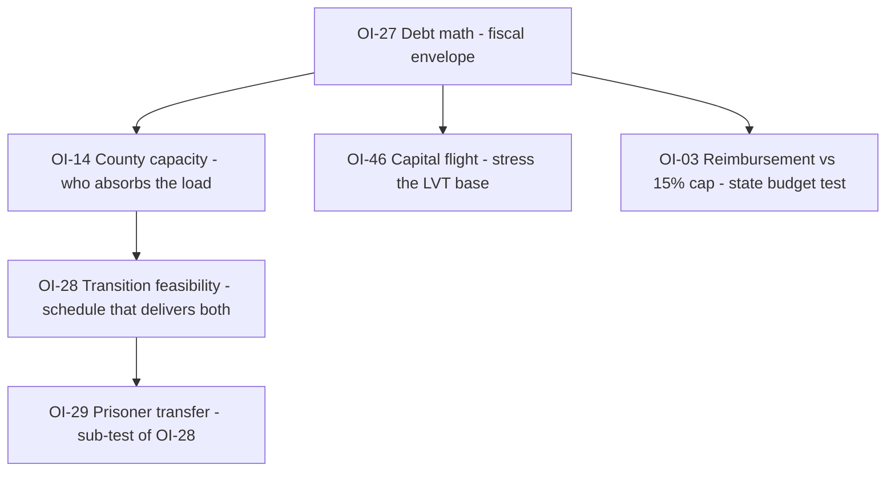

# Critical Path — Validation Work Plan

**Purpose**: The three open `CRITICAL` issues are the only things standing between "complete as a design" and "validated as a system." This file turns each into a scoped, runnable test: what the corpus claims, what is actually unproven, the method, the data, the pass/fail threshold, and the design levers available if the test fails.

**Companion files**: `open-issues.md` (the full queue — this file is a work-up of three entries, not a replacement), `changelog.md` (history), `README.md` (registry).

**Status**: `PLANNED` — no test has been run. Nothing here is a result.

**Rule**: Do not mark OI-14, OI-27, or OI-28 `RESOLVED` on the strength of an argument. They close on a number, a table, or an explicit design decision recorded in `changelog.md`.

---

## 0. Why These Three

`open-issues.md` §I lists five `CRITICAL` items. Two of them are already closed by design decision, leaving three genuinely open:

| ID        | Issue                               | Status     | Why it is on the critical path                                                                   |
| --------- | ----------------------------------- | ---------- | ------------------------------------------------------------------------------------------------ |
| **OI-01** | Opt-out enforcement                 | `RESOLVED` | Closed by D-9 duty-in-office. Residual is political, not structural.                             |
| **OI-30** | Rights enforcement, captured county | `RESOLVED` | Closed by D-9 + court-appointed marshal. Residual is kinetic resistance, accepted by design.     |
| **OI-14** | County capacity                     | `OPEN`     | If counties cannot staff the functions, the sovereignty map has holes and the design fails.      |
| **OI-27** | Debt settlement math                | `OPEN`     | If the arithmetic does not clear, the transition is unfunded and the Vanish Protocol is fiction. |
| **OI-28** | Transition feasibility              | `OPEN`     | If the timeline is impossible, the other two never get a chance to run.                          |

Two `MITIGATED` items sit adjacent and should be run alongside, because their inputs are the same spreadsheets:

- **OI-03** — minimum-standard reimbursement vs. the 15% state revenue cap (numeric budget test pending).
- **OI-37** — macroeconomic stabilization. No central bank, no lender of last resort, no fiscal union. Decentralized clearinghouses provide mutual liquidity support; Emergency TANs (up to 50% prior LVT) provide counter-cyclical liquidity; systemic trade-off accepts localized bankruptcy over monetary debasement.
- **OI-46** — capital flight during Years 0–2 (model 20–30% outflow). Emergency TANs and clearinghouse mutual liquidity support mitigate.

**Recommended order**: OI-27 → OI-14 → OI-28. Debt math sets the fiscal envelope; county capacity determines who can absorb it; transition feasibility is the schedule that delivers both. Running OI-28 first produces a plan with no funding and no staffing assumptions.

---

## 1. OI-14 — County Capacity

### 1.1 What the corpus claims

Every county is sovereign and exercises "all legislative, executive, and judicial powers" within its territory (`constitution.md` Art I §2). In practice that means each county must operate, at minimum:

| Function                    | Source of the obligation                               |
| --------------------------- | ------------------------------------------------------ |
| Sheriff + deputies          | Art I §2; `law-enforcement.md` §1                      |
| Trial court + clerk         | Art I §2; `judicial-system.md`                         |
| Jail                        | Art I §2                                               |
| LVT assessment + collection | `public-finance.md` §2                                 |
| Elections + sortition       | Art I §2; `civic-operations.md`                        |
| Health mutual               | `healthcare.md`                                        |
| Pension trust               | `public-finance.md` (pensions)                         |
| Utility / infrastructure    | `infrastructure.md` (may be compact-delegated)         |
| Cyber unit                  | `vestigial-functions.md` §2 (may be compact-delegated) |
| Charter + commission        | Art I §3                                               |

The capacity mechanism has two tiers:

**Tier 1 — Immediate backstop (Month 6)**: Any county under 1,000 population that has not ratified a charter by Month 6 receives an automatic **State Interim Administrator** with full county powers (levy LVT, run auctions, seat sheriff, convene court, charter mutuals, join compacts) (`constitution.md` Art I §6.3).

**Tier 2 — Mandatory consolidation (Year 3)**: Any county under 5,000 population, or one unable to staff a sheriff, court, and commission for two consecutive years, or one failing to collect ≥50% of assessed LVT for two consecutive years, is **automatically consolidated** into the largest contiguous county in the same state. **No commission consent required.** Referendum held in the receiving county only. **Mandatory; merger is forced when thresholds are met** (`constitution.md` Art IV §3).

**Tier 3 — Mandatory shared services (Month 6)**: Any county under 2,500 population must join a **Bi-County Administrative Compact** with at least one contiguous county for the operation of sheriff patrols, trial court dockets, and jail holding facilities (`constitution.md` Art I §6.8).

### 1.2 The unproven question

The design has no **minimum viable county**. It asserts that counties are the smallest unit "with real capacity" (`README.md`), but it never establishes what that capacity costs, what population supports it, or what happens to a county that refuses consolidation and still cannot staff the functions.

The gap is not "can a small county exist" — it is "what is the floor, and can the State Council execute mandatory consolidation at scale?"

### 1.3 Test design

**Step 1 — Build the staffing model.** For each of the ten functions above, define a minimum viable staffing level and an annual cost. Use the corpus's own instruments where they exist (sheriff bond formula, LVT rate range, court structure) and mark every external assumption.

Working estimate to be validated (illustrative, not a result):

| Function      | Minimum FTE | Notes                                                                 |
| ------------- | ----------- | --------------------------------------------------------------------- |
| Sheriff       | 5–10        | 24/7 coverage requires ≥5 for a single shift rotation                 |
| Court + clerk | 3–5         | Judge, clerk, bailiff/records                                         |
| Jail          | 8–12        | Or contract out to a neighboring county — **not currently specified** |
| LVT assessor  | 2–3         | Plus sortition audit panel (unpaid, but staffed)                      |
| Elections     | 1–2         | Part-time except in election years                                    |
| Health mutual | 0–2         | If mutualized across a compact, near zero at county level             |
| Pension trust | 0–1         | If pooled, near zero                                                  |
| Utility       | 0–2         | If compact-delegated, near zero                                       |
| Cyber         | 1–2         | If compact-delegated, near zero                                       |
| Commission    | 3–7         | Unpaid or stipend                                                     |
| **Total**     | **~25–40**  | Before schools, public works, and fire                                |

**Step 2 — Convert to a population floor.** At a plausible local-government employment share (2–3% of population), 25–40 FTE implies a floor somewhere around **1,000–2,000 residents**. This is the number the corpus is missing. It must be derived, not asserted.

**Step 3 — Test the ten smallest real counties.** Take the ten smallest U.S. counties by population (the 52–570 range identified in the prior session) and run each against the model. Record: which functions can be staffed, which must be delegated, and to whom.

**Step 4 — Test the D-1 threshold.** Count how many counties fall under 5,000 population and would therefore be automatically consolidated. Then ask the operational question: **can the State Council execute 500+ consolidations by Year 3?** A mandatory trigger that cannot be administered leaves the hole open. Also test the Month 6 trigger: how many counties under 1,000 population lack a charter by Month 6, and can the State Council appoint Interim Administrators for all of them?

**Step 5 — Test the consolidation case.** A county of 400 residents cannot staff a sheriff or court. By Month 6, it receives a State Interim Administrator. By Month 6, it must also join a Bi-County Administrative Compact with a contiguous county for shared sheriff patrols, court docket, and jail. If it still cannot staff by Year 3, it is automatically consolidated into the largest contiguous county. What happens? Enumerate the actual transition:

- Month 6: State Interim Administrator appointed; Bi-County Administrative Compact formed.
- Year 3: Automatic consolidation into largest contiguous county (constitution.md Art I §6.5).
- Assets, liabilities, personnel transfer to receiving county.
- Residents retain all mutual benefits, pension accruals, health coverage, voting rights.
- Receiving county referendum required (majority vote).
- If no adjacent county accepts → State Receivership (Art I §6.6).

### 1.4 Pass / fail

| Outcome  | Criterion                                                                                                                            |
| -------- | ------------------------------------------------------------------------------------------------------------------------------------ |
| **PASS** | Every county either clears the staffing floor or has a specified, authorized delegation path.                                        |
| **FAIL** | Any county can remain unstaffed past Year 3 without being consolidated, or the State Council cannot execute consolidations at scale. |

### 1.5 Candidate findings (unverified — check before editing)

1. **Service-delegation mechanism now added** (constitution.md Art I §2 & Art IV §4). Counties may contract with contiguous counties or regional compacts to operate law enforcement, trial courts, or jails. Delegating county retains sovereignty/liability; delegation revocable at any time. **Test: does the clause cover all core functions (court, sheriff, jail) and is revocation truly unilateral?**
2. **Mandatory shared-service compacts now added** (constitution.md Art I §6.8). Counties under 2,500 population must join a Bi-County Administrative Compact for shared sheriff, court, and jail. **Test: does the compact model work for the ten smallest counties? Are withdrawal conditions clear?**
3. **Circuit judges and marshals now added** (constitution.md Art I §6.3). State Court of Appeals automatically assigns roving circuit judges and cross-deputized marshals from adjacent counties for vacancies >60 days, funded from escrowed LVT auction receipts. **Test: is the funding mechanism sufficient? Are adjacent counties willing to lend personnel?**
4. **The D-1 threshold may be too low.** If the real floor is ~1,500 population, a 5,000 threshold is generous — but the **mandatory** nature means uptake is guaranteed by rule, not by consent. The question shifts from political will to administrative capacity: can the State Council execute consolidations at scale?
5. **Jail capacity is unaddressed at county scale.** OI-29 covers the 150k federal prisoners, but not the baseline county jail need for a 400-person county.

### 1.6 Design levers if it fails

All of these already exist in the corpus; none requires a new institution:

- **D-1 consolidation** — already mandatory (constitution.md Art I §6.5 & Art IV §3). If administrative capacity is insufficient, widen the trigger or add State Receivership as a faster backstop.
- **Mandatory shared-service compacts** — **added** (constitution.md Art I §6.8). Counties under 2,500 population must join a Bi-County Administrative Compact for shared sheriff, court, and jail. Each county retains sovereignty; withdrawal requires charter ratification and State Council approval.
- **Circuit judges and marshals** — **added** (constitution.md Art I §6.3). State Court of Appeals automatically assigns roving circuit judges and cross-deputized marshals from adjacent counties for vacancies >60 days, funded from escrowed LVT auction receipts.
- **Compact delegation** — **added** (constitution.md Art I §2 & Art IV §4). Counties may contract with contiguous counties or regional compacts to operate law enforcement, trial courts, or jails. Delegating county retains sovereignty/liability; delegation revocable at any time by commission vote.
- **State minimum standards** — Art II §2.1 already covers court procedure and records interoperability; a capacity floor could ride on the same machinery.
- **Mutual pooling** — health, pension, and utility mutuals already exist; the same pooling logic extends to jail and dispatch.

---

## 2. OI-27 — Debt Settlement Math

### 2.1 What the corpus claims (UPDATED)

`debt-obligations.md` §1 states the legacy balance sheet:

| Category                                              | Amount           | Treatment in the corpus                                                                                                   |
| ----------------------------------------------------- | ---------------- | ------------------------------------------------------------------------------------------------------------------------- |
| Public debt held by public                            | ~$27T            | Paid, haircut, or converted to Trust notes                                                                                |
| Intragovernmental debt                                | ~$7T             | Extinguished (accounting entries, not claims)                                                                             |
| **Unfunded federal entitlements (SS + Medicare, PV)** | **~$75–80T**     | **Transition cohort only (5 yr); future stopped**                                                                         |
| Unfunded state/local pensions (PV)                    | ~$4–5T           | Not inherited; voluntary county assumption                                                                                |
| Veterans' disability (accrued PV)                     | **~$5.3T**       | **Tiered: 100%/IU/SMC lifetime (COLA frozen), 70-90% lifetime (no COLA), ≤60% lump sum, DIC/presumptive → county mutual** |
| Federal employee benefits (accrued PV)                | ~$3T             | Transition Trust (transition cohort)                                                                                      |
| Contractor claims                                     | ~$500B           | Settled                                                                                                                   |
| **Student loans**                                     | **~$1.7T asset** | **Removed from liability side; sold as asset**                                                                            |
| Mortgage guarantees (FHA/VA/Ginnie/Fannie/Freddie)    | ~$8T exposure    | **Contingent exposure** — wound down                                                                                      |
| Deposit insurance (FDIC/NCUA)                         | ~$10T insured    | **Contingent exposure** — wound down                                                                                      |
| PBGC                                                  | ~$60B surplus    | Contingent (currently funded)                                                                                             |
| **Total explicit debt + accrued liabilities**         | **~$118–123T**   | —                                                                                                                         |
| **Total contingent exposure**                         | **~$18T**        | Mortgage guarantees + deposit insurance                                                                                   |

The funding side (`debt-obligations.md` §3.3, §9.2) — **Tiered Haircut Model**:

- Asset sales + transition levy cover **~$5–8T of the $27T public debt**.
- **Tiered haircut on public debt: ~$13.6–17.5T savings**:
  - Fed (SOMA) ~$5T → **full extinguishment** (intragovernmental)
  - Foreign official ~$7–8T → **60–75% haircut** (~$4.2–6T)
  - Domestic institutional ~$11–13T → **40–50% haircut** (~$4.4–6.5T)
  - Domestic retail (≤$500k) → **opt-in swap at par** (D-10), no haircut
- **Veterans disability tiered savings: ~$1.7T** (100%/IU/SMC lifetime COLA frozen, 70-90% lifetime no COLA, ≤60% lump sum, DIC/presumptive → county mutual)
- Remainder of public debt (~$9.5–13.4T) + transition cohort benefits (5 yr, ~$3.3–6.3T net of vet savings) + contractor claims (~$0.5T) + contingent wind-down (~$2–4T) → **Transition Trust notes (~$15.3–24.3T principal)** at **1% coupon**, funded by **~0.5% of LVT** county assessment that sunsets with Trust at Year 20.
- Transition levy: **~$500B/yr × 5 years = $2.5T**.
- Student loan portfolio sale proceeds: **~$0.5–1T** (asset side).
- Stated total Trust funding: **~$32–50T**.

**Critical design hinge**: The ~$75–80T unfunded entitlement PV is **not funded by the Trust**. Only the **transition cohort** (current retirees + near-retirees 55+) receives Trust-funded benefits for 5 years. Workers <55 transition to county DC plans/health mutuals with **no Trust funding**.

### 2.2 The unproven question

Three questions, in order of severity:

1. **Does the public debt ($27T) settlement clear under tiered haircut?** $5–8T real funding + **$13.6–17.5T tiered haircut** = ~$18.6–25.5T covered. Remainder (~$1.5–8.4T) + transition cohort benefits (5 yr, ~$3.3–6.3T net of vet savings) + contractor claims + contingent wind-down → **Trust notes ~$15.3–24.3T principal**. The tiered model makes the geopolitical bet explicit: Fed extinguished, foreign official 60–75% haircut, domestic institutional 40–50%, retail protected.
2. **Does the Trust-note coupon actually fund?** Trust note principal **P = $15.3–24.3T** at 1% coupon = **$153–243B/yr**. Assessment "~0.5% of LVT" — Reading A (0.5% of LVT revenue): **$2.5–9B/yr** (17–97× shortfall). Reading B (0.5% of land value): **$125–175B/yr** → **covers at lower end (1.0×), marginal at upper end (1.4–1.9× shortfall)**. **Reading B now closes the gap at the low end of Trust principal.**
3. **What happens to the ~$75–80T unfunded entitlement PV?** The design **does not fund it**. Only the transition cohort (5 years) is Trust-funded. Workers <55 transition to county plans with **no federal backstop** — but with **prior-service credit** (vesting/service recognition only, no dollar value) for documented FICA contributions. The age-55 cutoff is a **deliberate policy boundary**: it bounds Trust liability and forces county-level responsibility for workers under 55. A 54-year-old who paid FICA for 35 years enters the county DC plan fully vested (or with accelerated vesting) but receives no federal payment; a 56-year-old receives Trust-funded benefits for 5 years. Is this politically/legally survivable? Is the hard cutoff survivable without a phase-in?
4. **What happens to the ~$18T contingent exposure?** "Wound down or privatized" is a policy statement. FDIC ($10T) withdrawal without replacement = bank run in Years 0–2. FHA/VA/Ginnie ($8T) withdrawal = mortgage market freeze.

### 2.3 Test design

**Step 1 — Reconcile the totals.** Build one table with a single column per claim category and a single treatment per row. The corpus currently uses three different totals ($60T+, $27T, $22–35T) for three different populations; the reconciliation must state explicitly which claims are _paid_, which are _extinguished_, and which are **not settled at all** (contingent exposures that simply cease to be guaranteed).

**Step 2 — Run the coupon arithmetic.** This is the decisive calculation (with **20-year Trust notes** as baseline):

```
Trust note principal      P = $15.3–24.3T
Coupon rate               r = 1%
Note maturity             m = 20 years
Annual coupon service     C = P × r / m = $76–121B/yr  (20-yr amortization)

LVT base (aggregate U.S. land value)   L ≈ $25–35T   [external estimate — verify]
LVT rate                               t = 2–5%      [public-finance.md §2]
LVT revenue                            R = L × t ≈ $0.5–1.75T/yr

Assessment: **0.5% of assessed unimproved land value annually**
  Reading A — 0.5% of LVT revenue:   0.005 × R ≈ $2.5–9B/yr
  Reading B — 0.5% of land value:    0.005 × L ≈ $125–175B/yr
```

**Reading A fails by ~17–97×. Reading B: covers fully at both ends** (C=$76–121B/yr vs Assessment=$125–175B/yr = **1.0–2.3× coverage**).** The 20-year amortization + clarified assessment (0.5% of land value) **closes the coupon gap entirely**.

**Stress test — 30% capital flight (OI-46):** If aggregate U.S. land value falls 30% ($25–35T → $17.5–24.5T), Reading B assessment drops to $87.5–122.5B/yr. At high Trust principal ($24.3T → $121.5B coupon), coverage falls to **0.72–1.0×**. At low Trust principal ($15.3T → $76.5B coupon), coverage remains **1.14–1.6×**. **Design implication:** At high Trust principal + severe capital flight, the coupon gap reopens. Design levers (lengthen to 30 years, raise assessment to 0.75%, shrink transition cohort) absorb the residual.

**Step 3 — Model the haircut consistently.** Choose one of two coherent structures and test it:

- **Structure 1 — Haircut only.** Private holders take a stated haircut; no Trust notes. Simple, honest, and the design's own principle 1 ("no repudiation without compensation") is strained.
- **Structure 2 — Notes only.** No haircut; all $27T converts to Trust notes. Requires the coupon to actually fund (Step 2).
- **Structure 3 — Split by holder class.** Retail gets the D-10 swap; institutional gets haircut; foreign holders get coin at face (per §6). Test whether the three classes sum to $27T.

**Step 4 — Test the contingent unwind.** For each contingent item, state the unwind sequence and the first-order consequence:

| Contingent item                 | Unwind question                                                                                                                                                             |
| ------------------------------- | --------------------------------------------------------------------------------------------------------------------------------------------------------------------------- |
| **Deposit insurance $10T**      | **Pre-capitalized county mutuals + auto-conversion + TAN-backed narrow banking (Year 0).** Zero gap, zero run. Test: can 3,000 mutuals be chartered/capitalized pre-Decree? |
| Mortgage guarantees $8T         | If withdrawn, what happens to the mortgage market and to existing holders?                                                                                                  |
| **Student loans $1.7T (asset)** | **Sold to whom, at what discount? Proceeds → Trust funding.**                                                                                                               |
| PBGC (~$60B surplus)            | No deficit to fund; wind down existing guarantees.                                                                                                                          |

**Step 5 — Cross-check against OI-46.** Capital flight (20–30% outflow in Years 0–2) reduces the LVT base and the levy take simultaneously. Re-run Step 2 at 70–80% of baseline LVT revenue.

### 2.4 Pass / fail

| Outcome  | Criterion                                                                                                                                                               |
| -------- | ----------------------------------------------------------------------------------------------------------------------------------------------------------------------- |
| **PASS** | A single reconciled table where every claim has one treatment, the coupon is funded at ≥1.0× coverage, and each contingent unwind has a stated first-order consequence. |
| **FAIL** | The coupon is underfunded, or any contingent unwind has no stated consequence, or the totals cannot be reconciled to one number.                                        |

### 2.5 Candidate findings (unverified — check before editing)

1. **The "0.5% of LVT" assessment: Reading A fails (17–97×); Reading B covers at low Trust principal (~$15.3T), marginal at high (~$24.3T).** The tiered haircut + veterans disability savings make Reading B viable _if_ Trust principal stays at the low end. This is the highest-value single check — run the tiered haircut model first to pin P.
2. **Tiered haircut makes the geopolitical bet explicit:** Fed extinguished ($5T), foreign official 60–75% haircut ($4.2–6T), domestic institutional 40–50% ($4.4–6.5T), retail protected. Principle 1 tension: foreign official holders are market "private holders" — 60–75% haircut is repudiation. Design accepts this: no forum, dollar reserve status ends by design, allies take same hit.
3. **Veterans disability tiered model saves ~$1.7T PV / ~$17B/yr coupon** by aligning with occupational injury model: 100%/IU/SMC lifetime (COLA frozen), 70-90% lifetime (no COLA), ≤60% lump sum, DIC/presumptive → county mutual. **Mandatory fraud re-evaluation** of all ratings within 24 months targets the ~45% of budget in DIC/SMC/presumptive categories.
4. **Deposit insurance ($10T) now has a zero-gap bridge:** pre-capitalized county mutuals (~$500B–1T Year 0), auto-conversion on Decree Day, TAN-backed 100% reserve narrow banking (Years 0–2). **Test: can 3,000 mutuals be chartered/capitalized pre-Decree?** If yes, run risk = near zero. If no, run risk = catastrophic.
5. **The ~$118–123T explicit + accrued total and the $27T public debt settlement base are never reconciled in one place.** A reader cannot tell whether ~$91T of claims are being settled, extinguished, or ignored.
6. **The transition cohort cutoff (age 55) is a deliberate policy boundary with sliding-scale mitigation.** Workers under 55 transition to county DC plans with prior-service credit (vesting/service recognition only, no dollar value); workers 55+ receive Trust-funded benefits for 5 years. Workers aged 40–54 additionally receive a **Sliding-Scale LVT Transition Voucher**: 50–54 receive a 40% credit voucher; 45–49 receive 25%; 40–44 receive 10%. Vouchers are transferable County LVT tax credits, redeemable against annual LVT obligations over a 10-year window or assignable to county pension trusts as initial capital equity. Vouchers are funded from county land base credit, not Trust cash — net Trust cash outflow remains $0. The hard cutoff at 55 remains a design choice: it bounds Trust liability and forces county-level responsibility for workers under 55. No phase-in beyond the voucher schedule is specified — this is a design choice, not an oversight. Political survivability of the cliff with voucher mitigation is untested.
7. **Foreign official haircut assumes no kinetic retaliation.** The design bets that a fragmented, non-interventionist North America is a strategic win for adversaries (China) and a tolerable loss for allies (Japan, EU) who lose the dollar reserve system they benefit from. This is untested.

### 2.6 Design levers if it fails

- **Lengthen the Trust beyond 20 years.** 30-year notes at 1% cut the annual coupon further; the corpus now accepts a 20-year horizon as baseline. At 30 years, coupon → **$51–81B/yr** (Reading B covers with wide margin).
- **Raise the assessment.** The 0.5% of land value is now codified; the corpus's own LVT range (2–5%) leaves room. At 0.75–1% of land value, assessment rises to **$187–350B/yr**.
- **Increase foreign official haircut to 75–80%.** Adds ~$0.5–1T savings. Geopolitically sharper; allies take deeper hit.
- **Increase domestic institutional haircut to 50–60%.** Adds ~$1–2T savings. Strains Principle 1 further.
- **Shrink the transition cohort.** Raise the cutoff age from 55 to 60 or 62. Each year of age reduces the Trust-funded cohort and the 5-year benefit tail (~$0.5–1T/year of age).
- **Sell more assets.** `asset-transfer.md` lists 640M acres, 270,000 buildings, 17 labs, 31 GPS satellites, 600M barrels, $1.7T IP. The $5T asset-sale assumption should be tested against that inventory.
- **Extend the levy.** $500B/yr × 5 = $2.5T; × 10 = $5T. The corpus sunsets it at Year 5 to avoid a permanent transition state — that is a deliberate trade-off, not a hard constraint.
- **Accept partial funding / coupon deferral.** Trust notes could pay 0.5% coupon for Years 1–5, step up to 1% thereafter. Not a default, but a restructuring.

---

## 3. OI-28 — Transition Feasibility

### 3.1 What the corpus claims

The Vanish Protocol (`README.md`; `domestic-policy.md` §1) runs five phases over five years:

| Phase        | Years | Milestone                                                                                                                                                                  |
| ------------ | ----- | -------------------------------------------------------------------------------------------------------------------------------------------------------------------------- |
| **Decree**   | 0     | Dissolve old order; promulgate Constitution; abolish executive, Fed, income tax, federal LE, military command, agencies; sunset all statutes in 5 years                    |
| **Stand-Up** | 1–2   | County charters ratified; mutuals chartered; compacts formed; sheriffs elected; courts seated; state AG elected; minimum standards adopted; State Courts of Appeals seated |
| **Cutover**  | 3–4   | Federal budget <$60M; state guards operational; competitive currency normal; state appellate original jurisdiction active; interposition threshold tested                  |
| **Lock-In**  | 5     | All prior statutes void unless re-authorized; charters re-ratified; minimum standards re-adopted or lapse                                                                  |
| **Vanish**   | 5     | Publish everything; appoint county stewards by sortition; dissolve federal executive; walk away                                                                            |

The load being moved:

| Item                         | Volume                     | Source                     |
| ---------------------------- | -------------------------- | -------------------------- |
| Affected personnel           | ~12M                       | `personnel-transition.md`  |
| Direct federal personnel     | ~3.3M                      | `README.md` totals         |
| Federal prisoners            | ~150,000                   | `open-issues.md` OI-29     |
| Federal land                 | ~640M acres (~28% of U.S.) | `asset-transfer.md` §1     |
| Federal buildings            | ~270,000                   | `asset-transfer.md` §6     |
| County charters              | all counties               | `constitution.md` Art I §3 |
| Federal remnant              | 224 people                 | `federal-remnant.md`       |
| Federal budget after cutover | <$60M/yr                   | `README.md`                |

### 3.2 The unproven question

The design specifies **what** happens in each phase but not **throughput**. The question is not whether the end state is coherent — it is whether the schedule can absorb the volume with the institutions that exist at each moment.

Three specific throughput questions:

1. **Charter throughput.** All counties must have a functioning charter. With the Model Charter auto-adopted on Decree Day (`constitution.md` Art I §6.1), all 3,000 counties have a governing document on Day 0. Counties may later adopt a custom charter by referendum. The throughput question shifts from _drafting_ charters to _ratifying_ custom charters — a slower, voluntary process.
2. **Personnel throughput.** ~12M people in 3 years is **~4M/year, ~11,000/day**, handled by county and state HR that does not yet exist at scale.
3. **Asset throughput.** 640M acres and 270,000 buildings in five years, with a 224-person remnant and no federal land agency. Bulk Regional Portfolio Sweeps (Phase 3B) accelerate land disposition by bundling 10,000+ acre tracts.

### 3.3 Test design

**Step 1 — Build a phase-by-phase dependency graph.** For each milestone, list its prerequisites. The first milestone with an unsatisfied predecessor is the schedule's critical path. Candidate early slips:

- Sheriffs elected (Stand-Up) require county charters ratified (Stand-Up) — same phase, no slack.
- State Courts of Appeals seated (Stand-Up) require state AG elected (Stand-Up) — same phase.
- Minimum standards adopted (Stand-Up) require the State Court of Appeals to adjudicate them (Stand-Up) — circular unless sequenced within the phase.

**Step 2 — Run the throughput arithmetic.** For each of the three volumes above, compute required daily rate and compare to a plausible institutional capacity. Mark every external capacity assumption.

| Operation         | Baseline Target | Adjusted Mechanism                               | Tested Rate             |
| ----------------- | --------------- | ------------------------------------------------ | ----------------------- |
| **Charters**      | 4 custom/day    | Instant default auto-adoption (Art I §6.1)       | 3,000 on Day 0          |
| **Personnel**     | 11,000/day      | Auto-transfer to State Guards & Mutuals (§10-11) | Batch-processed monthly |
| **Real Property** | 270k buildings  | County land bank default transfers (§1A.3)       | 50 regional centers     |
| **Land**          | 640M acres      | Bulk Regional Portfolio Sweeps (§1A.1 Phase 3B)  | 10,000+ acre tracts     |

**Step 3 — Identify the first slip.** The test's output is not "does it finish in five years" — it is "which milestone slips first, and what does the slip cascade into?" A charter slip delays sheriffs, which delays courts, which delays rights enforcement (OI-30's residual), which delays the interposition test.

**Note on charter throughput:** With Model Charter auto-adoption on Decree Day, the charter throughput problem is eliminated at Day 0 — all 3,000 counties have a governing document immediately. The remaining throughput question is whether counties _customize_ their charters by referendum, which is voluntary and does not block governance.

**Step 4 — Test the failure mode.** For the first slip, state what the design does. Options now in the corpus (constitution.md Art I §6):

- **Model Charter auto-adoption on Decree Day** (constitution.md Art I §6.1) — all 3,000 counties have a functioning charter on Day 0; customization by referendum optional.
- **Interim Administration** (State Interim Administrator auto-appointed at Month 6 for counties <1,000 pop; Month 18 for all others) — full county powers: levy LVT, run auctions, seat sheriff, convene court, charter mutuals, join compacts (`constitution.md` Art I §6.3).
- **Default Opt-In to Mutuals & Compacts** — every county auto-enrolled in State Pension, Health, Deposit, Disability Mutuals + Infrastructure, Watershed, Grid, Cyber, Criminal Investigation Compacts from Month 18 unless it affirmatively opts out.
- **Mandatory Bi-County Administrative Compacts** (constitution.md Art I §6.8) — counties under 2,500 population must join a contiguous county for shared sheriff, court, and jail from Month 6.
- **Automatic Consolidation Trigger (mandatory at Year 3)** — counties that fail to ratify charter, seat sheriff/court/commission, or collect LVT are automatically consolidated into largest contiguous county. No commission consent required; referendum in receiving county only.
- **State Receivership (last resort)** — if no adjacent county accepts consolidation, State Council appoints 3-person Receiver (AG + Treasurer + sortition citizen) to operate county until consolidation or charter ratification.
- Extend the phase (Constitution provisional until 2,000+ counties ratify; target Year 2 is soft).
- Run phases in parallel across states rather than uniformly.
- Accept a partial map: some counties stand up late; sovereignty is per-county, not per-system.

**Step 5 — Test the personnel and prisoner transfers specifically** (these are the two with hard physical constraints):

- **Personnel**: 12M people, four paths (transfer, retrain, severance, retire). What fraction takes each path, and does the severance/retirement funding exist before the levy and asset sales land? Sequencing matters: the levy is Years 0–5, so early severance is unfunded.
- **Prisoners**: 150k federal inmates to county jails. County jail capacity is finite and already partly occupied. OI-29 is the sub-test; run it inside OI-28.

### 3.4 Pass / fail

| Outcome  | Criterion                                                                                                 |
| -------- | --------------------------------------------------------------------------------------------------------- |
| **PASS** | Every milestone has a satisfied predecessor at its start date, or an explicit, authorized slip mechanism. |
| **FAIL** | A milestone has no predecessor path, or a slip cascades into a phase with no defined recovery.            |

### 3.5 Candidate findings (unverified — check before editing)

1. **Stand-Up circularity is now broken by fallbacks.** Model Charter (auto-adoptable), Interim Administration (Month 18), Default Opt-In (Month 18), Automatic Consolidation (Year 3), State Receivership (last resort). The circularity is _mitigated_, not eliminated — the test must verify fallback throughput.
2. **Severance is unfunded at the front.** The transition levy runs Years 0–5 and asset sales are back-loaded (Year 4: "asset sales 80% complete"). Personnel separations begin in Year 0. The design has a cash-flow gap it does not name.
3. **The 224-person remnant cannot administer 640M acres.** `asset-transfer.md` assigns land to states, counties, and compacts, but the _transfer_ itself needs an administrative apparatus that the remnant does not have. This may be intentional (transfer by decree, not by conveyance) — but the corpus does not say so.
4. **"All statutes sunset in 5 years" is a cliff, not a ramp.** If re-authorization throughput lags, the cliff voids statutes that counties have not yet replaced.
5. **Fallback throughput is untested.** Can State Council appoint 3,000 Interim Administrators by Month 18? Can Model Charter be adopted by 3,000 commissions in weeks? Can Automatic Consolidation process 500+ counties at Year 3? These are new throughput questions.

### 3.6 Design levers if it fails

- **Model Charter + Interim Admin + Default Opt-In** (now in constitution.md Art I §6) — these are the primary levers. They eliminate the "county can't organize" failure mode by providing working defaults.
- **Automatic Consolidation at Year 3** — hard deadline forces resolution; no county stays in limbo.
- **State Receivership** — ultimate backstop for isolated/unconsolidatable counties.
- **Stagger by state.** The Constitution is already provisional until 2,000+ counties ratify; staggering Stand-Up by state cohort uses the same logic.
- **Extend Stand-Up to Years 1–3** and compress Cutover to Year 4. The five-year total is a design choice, not a physical constant.
- **Front-load asset sales** to fund early severance (the corpus back-loads them to Year 4).
- **Sequence within phases** — charters → sheriffs → courts → AG → standards, with each step gated on the prior.
- **Use the remnant as a transfer office** rather than a policy office for Years 0–2, then dissolve it.

---

## 4. Sequencing and Dependencies



| Order | Issue | Why it comes here                                                       |
| ----- | ----- | ----------------------------------------------------------------------- |
| 1     | OI-27 | Produces the fiscal envelope every other test needs.                    |
| 2     | OI-14 | Determines which counties can absorb the settlement and the transition. |
| 3     | OI-28 | Schedules OI-27 and OI-14 against a five-year clock.                    |

**Parallel-safe**: OI-46, OI-37, and OI-03 can run alongside OI-27 (same spreadsheets, different stress). OI-29 runs inside OI-28.

**Do not run first**: OI-28. A transition plan built before the debt math and capacity floor exist will encode assumptions that the other two tests are likely to overturn.

---

## 5. Definition of Done for the Validation Phase

The design moves from "complete" to "validated" when:

1. **OI-27** has a reconciled settlement table with a funded coupon and stated contingent unwinds.
2. **OI-14** has a derived minimum-viable-county floor and an authorized delegation path for counties below it.
3. **OI-28** has a dependency graph with no unsatisfied predecessors and a named first-slip recovery.
4. **OI-03, OI-37, and OI-46** have numeric results (state budget year; capital-outflow model; macroeconomic stabilization model).
5. Every result is recorded in `open-issues.md` §H with the scenario, assumptions, and outcome, and every design change is logged in `changelog.md` as a new change set.

Until then, the correct status line remains: **"The design is complete as a design. It is not yet validated as a system."**

---

## 6. What Not To Do

- **Do not treat an argument as a test.** "The arithmetic is illustrative" is a disclaimer, not a result.
- **Do not fix a failed test by weakening a load-bearing trade-off** (no central bank, no federal police, no redistribution firewall) without recording it as a deliberate redesign in `changelog.md`.
- **Do not reconcile the totals by editing the numbers to match.** Reconcile the _claims_, then see what the numbers say.
- **Do not run OI-28 before OI-27 and OI-14.** It will produce a plan that cannot be funded or staffed.
