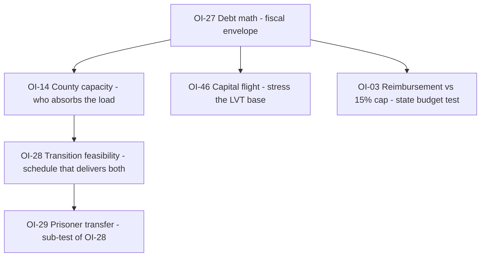

# Critical Path — Validation Work Plan

**Purpose**: The three open `CRITICAL` issues are the only things standing between "complete as a design" and "validated as a system." This file turns each into a scoped, runnable test: what the corpus claims, what is actually unproven, the method, the data, the pass/fail threshold, and the design levers available if the test fails.

**Companion files**: `open-issues.md` (the full queue — this file is a work-up of three entries, not a replacement), `changelog.md` (history), `README.md` (registry).

**Status**: `PLANNED` — no test has been run. Nothing here is a result.

**Rule**: Do not mark OI-14, OI-27, or OI-28 `RESOLVED` on the strength of an argument. They close on a number, a table, or an explicit design decision recorded in `changelog.md`.

---

## 0. Why These Three

`open-issues.md` §I lists five `CRITICAL` items. Two of them are already closed by design decision, leaving three genuinely open:

| ID        | Issue                               | Status     | Why it is on the critical path                                                                   |
| --------- | ----------------------------------- | ---------- | ------------------------------------------------------------------------------------------------ |
| **OI-01** | Opt-out enforcement                 | `RESOLVED` | Closed by D-9 duty-in-office. Residual is political, not structural.                             |
| **OI-30** | Rights enforcement, captured county | `RESOLVED` | Closed by D-9 + court-appointed marshal. Residual is kinetic resistance, accepted by design.     |
| **OI-14** | County capacity                     | `OPEN`     | If counties cannot staff the functions, the sovereignty map has holes and the design fails.      |
| **OI-27** | Debt settlement math                | `OPEN`     | If the arithmetic does not clear, the transition is unfunded and the Vanish Protocol is fiction. |
| **OI-28** | Transition feasibility              | `OPEN`     | If the timeline is impossible, the other two never get a chance to run.                          |

Two `MITIGATED` items sit adjacent and should be run alongside, because their inputs are the same spreadsheets:

- **OI-03** — minimum-standard reimbursement vs. the 15% state revenue cap (numeric budget test pending).
- **OI-46** — capital flight during Years 0–2 (model 20–30% outflow).

**Recommended order**: OI-27 → OI-14 → OI-28. Debt math sets the fiscal envelope; county capacity determines who can absorb it; transition feasibility is the schedule that delivers both. Running OI-28 first produces a plan with no funding and no staffing assumptions.

---

## 1. OI-14 — County Capacity

### 1.1 What the corpus claims

Every county is sovereign and exercises "all legislative, executive, and judicial powers" within its territory (`constitution.md` Art I §2). In practice that means each county must operate, at minimum:

| Function                    | Source of the obligation                               |
| --------------------------- | ------------------------------------------------------ |
| Sheriff + deputies          | Art I §2; `law-enforcement.md` §1                      |
| Trial court + clerk         | Art I §2; `judicial-system.md`                         |
| Jail                        | Art I §2                                               |
| LVT assessment + collection | `public-finance.md` §2                                 |
| Elections + sortition       | Art I §2; `civic-operations.md`                        |
| Health mutual               | `healthcare.md`                                        |
| Pension trust               | `public-finance.md` (pensions)                         |
| Utility / infrastructure    | `infrastructure.md` (may be compact-delegated)         |
| Cyber unit                  | `vestigial-functions.md` §2 (may be compact-delegated) |
| Charter + commission        | Art I §3                                               |

The only capacity mechanism in the corpus is **D-1**: a county under 10,000 population, or one unable to staff a sheriff, court, and commission for two consecutive years, receives an _automatic consolidation offer_ from the State Council — to the largest contiguous county in the same state. Consolidation requires commission consent plus a majority referendum in each affected county. It is **voluntary; no merger is forced** (`constitution.md` Art IV §3).

### 1.2 The unproven question

The design has no **minimum viable county**. It asserts that counties are the smallest unit "with real capacity" (`README.md`), but it never establishes what that capacity costs, what population supports it, or what happens to a county that refuses consolidation and still cannot staff the functions.

The gap is not "can a small county exist" — it is **"what is the floor, and is the voluntary offer sufficient to clear it?"**

### 1.3 Test design

**Step 1 — Build the staffing model.** For each of the ten functions above, define a minimum viable staffing level and an annual cost. Use the corpus's own instruments where they exist (sheriff bond formula, LVT rate range, court structure) and mark every external assumption.

Working estimate to be validated (illustrative, not a result):

| Function      | Minimum FTE | Notes                                                                 |
| ------------- | ----------- | --------------------------------------------------------------------- |
| Sheriff       | 5–10        | 24/7 coverage requires ≥5 for a single shift rotation                 |
| Court + clerk | 3–5         | Judge, clerk, bailiff/records                                         |
| Jail          | 8–12        | Or contract out to a neighboring county — **not currently specified** |
| LVT assessor  | 2–3         | Plus sortition audit panel (unpaid, but staffed)                      |
| Elections     | 1–2         | Part-time except in election years                                    |
| Health mutual | 0–2         | If mutualized across a compact, near zero at county level             |
| Pension trust | 0–1         | If pooled, near zero                                                  |
| Utility       | 0–2         | If compact-delegated, near zero                                       |
| Cyber         | 1–2         | If compact-delegated, near zero                                       |
| Commission    | 3–7         | Unpaid or stipend                                                     |
| **Total**     | **~25–40**  | Before schools, public works, and fire                                |

**Step 2 — Convert to a population floor.** At a plausible local-government employment share (2–3% of population), 25–40 FTE implies a floor somewhere around **1,000–2,000 residents**. This is the number the corpus is missing. It must be derived, not asserted.

**Step 3 — Test the ten smallest real counties.** Take the ten smallest U.S. counties by population (the 52–570 range identified in the prior session) and run each against the model. Record: which functions can be staffed, which must be delegated, and to whom.

**Step 4 — Test the D-1 threshold.** Count how many counties fall under 10,000 population and would therefore receive an offer. Then ask the political question: **what fraction of offers are likely to be refused?** A voluntary offer that is refused leaves the hole open.

**Step 5 — Test the refusal case.** A county of 400 residents refuses consolidation and cannot staff a sheriff or court. What happens? The corpus currently has no answer. Enumerate the actual options:

- Contract-in services from a neighboring county (is this authorized anywhere?).
- Compact delegation (does a compact have authority to run a county's court?).
- State receivership (does the state have this power? Art II does not grant it).
- De facto failure (no sheriff, no court — what does that mean for Art VI rights in that territory?).

### 1.4 Pass / fail

| Outcome  | Criterion                                                                                          |
| -------- | -------------------------------------------------------------------------------------------------- |
| **PASS** | Every county either clears the staffing floor or has a specified, authorized delegation path.      |
| **FAIL** | Any county can refuse consolidation and remain unstaffed, with no defined consequence or backstop. |

### 1.5 Candidate findings (unverified — check before editing)

1. **The corpus has no service-delegation mechanism.** Compacts coordinate; they do not appear to _operate_ a county's court or sheriff's office. If true, this is the single largest hole in OI-14 and the cheapest fix (a delegation clause in Art I §2 or Art IV).
2. **The D-1 threshold may be too low.** If the real floor is ~1,500 population, a 10,000 threshold is generous — but the _offer_ is voluntary, so the threshold's generosity does not guarantee uptake.
3. **Jail capacity is unaddressed at county scale.** OI-29 covers the 150k federal prisoners, but not the baseline county jail need for a 400-person county.

### 1.6 Design levers if it fails

All of these already exist in the corpus; none requires a new institution:

- **D-1 consolidation** — widen the trigger, or make the offer default-accept unless the county affirmatively declines with a staffing plan.
- **Compact delegation** — add an explicit clause allowing a county to delegate a function to a compact or a neighboring county by charter amendment.
- **State minimum standards** — Art II §2.1 already covers court procedure and records interoperability; a capacity floor could ride on the same machinery.
- **Mutual pooling** — health, pension, and utility mutuals already exist; the same pooling logic extends to jail and dispatch.

---

## 2. OI-27 — Debt Settlement Math

### 2.1 What the corpus claims

`debt-obligations.md` §1 states the legacy balance sheet:

| Category                        | Amount        | Treatment in the corpus                       |
| ------------------------------- | ------------- | --------------------------------------------- |
| Public debt held by public      | ~$27T         | Paid, haircut, or converted to Trust notes    |
| Intragovernmental debt          | ~$7T          | Extinguished (accounting entries, not claims) |
| Unfunded pensions               | ~$3.5T        | Funded trusts; future accrual stops           |
| Veterans' disability            | ~$150B/yr     | Flow, honored                                 |
| Federal employee benefits       | ~$100B/yr     | Flow, honored                                 |
| Contractor claims               | ~$500B        | Settled                                       |
| Student loans                   | ~$1.7T        | Portfolio sold or transferred                 |
| Mortgage guarantees             | ~$8T exposure | Contingent — wound down or privatized         |
| Deposit insurance               | ~$10T insured | Contingent — wound down or privatized         |
| PBGC deficit                    | ~$120B        | Contingent                                    |
| **Total explicit + contingent** | **~$60T+**    | —                                             |

The funding side (`debt-obligations.md` §3.3, §5):

- Asset sales + transition levy cover **~$5–8T of the $27T**.
- The remainder (**~$19–22T**) is handled by **haircut + 10-year Transition Trust notes** at a **1% coupon**, funded by a **~0.5% of LVT** county assessment that sunsets with the Trust at Year 10.
- Transition levy: **~$500B/yr × 5 years = $2.5T**.
- Stated total funding: **~$22–35T**.

### 2.2 The unproven question

Three questions, in order of severity:

1. **Does the $27T settlement clear?** $5–8T of real funding against $27T of claims means a $19–22T residual carried by Trust notes. That is a 70–80% conversion, not a haircut-plus-notes plan. The corpus describes a 40–50% haircut _and_ Trust-note conversion; those two cannot both apply to the same dollar.
2. **Does the Trust-note coupon actually fund?** This is a pure arithmetic check and it is the most likely place the design breaks.
3. **What happens to the ~$33T of contingent claims?** "Wound down or privatized" is a policy statement, not a settlement. Deposit insurance in particular ($10T insured) is a bank-run trigger if withdrawn without a replacement.

### 2.3 Test design

**Step 1 — Reconcile the totals.** Build one table with a single column per claim category and a single treatment per row. The corpus currently uses three different totals ($60T+, $27T, $22–35T) for three different populations; the reconciliation must state explicitly which claims are _paid_, which are _extinguished_, and which are **not settled at all** (contingent exposures that simply cease to be guaranteed).

**Step 2 — Run the coupon arithmetic.** This is the decisive calculation:

```
Trust note principal      P = $19–22T
Coupon rate               r = 1%
Annual coupon service     C = P × r = $190–220B/yr

LVT base (aggregate U.S. land value)   L ≈ $25–35T   [external estimate — verify]
LVT rate                               t = 2–5%      [public-finance.md §2]
LVT revenue                            R = L × t ≈ $0.5–1.75T/yr

Assessment as written: "~0.5% of LVT"
  Reading A — 0.5% of LVT revenue:   0.005 × R ≈ $2.5–9B/yr
  Reading B — 0.5% of land value:    0.005 × L ≈ $125–175B/yr
```

**Reading A fails by roughly 20–80×. Reading B is marginal at best.** If this holds, the Trust-note mechanism as written does not service its own coupon, and the design needs either a higher assessment, a longer maturity, a lower principal (bigger haircut), or a different instrument.

**Step 3 — Model the haircut consistently.** Choose one of two coherent structures and test it:

- **Structure 1 — Haircut only.** Private holders take a stated haircut; no Trust notes. Simple, honest, and the design's own principle 1 ("no repudiation without compensation") is strained.
- **Structure 2 — Notes only.** No haircut; all $27T converts to Trust notes. Requires the coupon to actually fund (Step 2).
- **Structure 3 — Split by holder class.** Retail gets the D-10 swap; institutional gets haircut; foreign holders get coin at face (per §6). Test whether the three classes sum to $27T.

**Step 4 — Test the contingent unwind.** For each contingent item, state the unwind sequence and the first-order consequence:

| Contingent item         | Unwind question                                                                           |
| ----------------------- | ----------------------------------------------------------------------------------------- |
| Deposit insurance $10T  | If withdrawn, what stops a bank run in Years 0–2? County mutuals are not yet capitalized. |
| Mortgage guarantees $8T | If withdrawn, what happens to the mortgage market and to existing holders?                |
| Student loans $1.7T     | Sold to whom, at what discount?                                                           |
| PBGC $120B              | Transferred to county pension trusts — which are themselves unfunded?                     |

**Step 5 — Cross-check against OI-46.** Capital flight (20–30% outflow in Years 0–2) reduces the LVT base and the levy take simultaneously. Re-run Step 2 at 70–80% of baseline LVT revenue.

### 2.4 Pass / fail

| Outcome  | Criterion                                                                                                                                                               |
| -------- | ----------------------------------------------------------------------------------------------------------------------------------------------------------------------- |
| **PASS** | A single reconciled table where every claim has one treatment, the coupon is funded at ≥1.0× coverage, and each contingent unwind has a stated first-order consequence. |
| **FAIL** | The coupon is underfunded, or any contingent unwind has no stated consequence, or the totals cannot be reconciled to one number.                                        |

### 2.5 Candidate findings (unverified — check before editing)

1. **The "0.5% of LVT" assessment is ambiguous and, on either reading, likely insufficient to service a $19–22T note at 1%.** This is the highest-value single check in the corpus. It should be run first.
2. **"40–50% haircut" and "remainder converted to Trust notes" are mutually exclusive as written.** A haircut reduces principal; conversion preserves it. The text applies both to the same residual.
3. **Deposit insurance is treated as contingent but is functionally a live liability** the moment the old regime stops backing it. The corpus has no bridge from FDIC to county mutuals.
4. **The $60T+ total and the $27T settlement base are never reconciled in one place.** A reader cannot tell whether $33T of claims are being settled, extinguished, or ignored.

### 2.6 Design levers if it fails

- **Lengthen the Trust.** 20–30 year notes at 1% cut the annual coupon proportionally; the corpus already accepts a 10-year horizon, so this is a parameter change, not a redesign.
- **Raise the assessment.** The 0.5% figure is illustrative; the corpus's own LVT range (2–5%) leaves room.
- **Increase the haircut.** The design already contemplates 40–50%; 60–70% is a policy choice, not a structural break.
- **Sell more assets.** `asset-transfer.md` lists 640M acres, 270,000 buildings, 17 labs, 31 GPS satellites, 600M barrels, $1.7T IP. The $5T asset-sale assumption should be tested against that inventory.
- **Extend the levy.** $500B/yr × 5 = $2.5T; × 10 = $5T. The corpus sunsets it at Year 5 to avoid a permanent transition state — that is a deliberate trade-off, not a hard constraint.

---

## 3. OI-28 — Transition Feasibility

### 3.1 What the corpus claims

The Vanish Protocol (`README.md`; `domestic-policy.md` §1) runs five phases over five years:

| Phase        | Years | Milestone                                                                                                                                                                  |
| ------------ | ----- | -------------------------------------------------------------------------------------------------------------------------------------------------------------------------- |
| **Decree**   | 0     | Dissolve old order; promulgate Constitution; abolish executive, Fed, income tax, federal LE, military command, agencies; sunset all statutes in 5 years                    |
| **Stand-Up** | 1–2   | County charters ratified; mutuals chartered; compacts formed; sheriffs elected; courts seated; state AG elected; minimum standards adopted; State Courts of Appeals seated |
| **Cutover**  | 3–4   | Federal budget <$60M; state guards operational; competitive currency normal; state appellate original jurisdiction active; interposition threshold tested                  |
| **Lock-In**  | 5     | All prior statutes void unless re-authorized; charters re-ratified; minimum standards re-adopted or lapse                                                                  |
| **Vanish**   | 5     | Publish everything; appoint county stewards by sortition; dissolve federal executive; walk away                                                                            |

The load being moved:

| Item                         | Volume                     | Source                     |
| ---------------------------- | -------------------------- | -------------------------- |
| Affected personnel           | ~12M                       | `personnel-transition.md`  |
| Direct federal personnel     | ~3.3M                      | `README.md` totals         |
| Federal prisoners            | ~150,000                   | `open-issues.md` OI-29     |
| Federal land                 | ~640M acres (~28% of U.S.) | `asset-transfer.md` §1     |
| Federal buildings            | ~270,000                   | `asset-transfer.md` §6     |
| County charters              | all counties               | `constitution.md` Art I §3 |
| Federal remnant              | 224 people                 | `federal-remnant.md`       |
| Federal budget after cutover | <$60M/yr                   | `README.md`                |

### 3.2 The unproven question

The design specifies **what** happens in each phase but not **throughput**. The question is not whether the end state is coherent — it is whether the schedule can absorb the volume with the institutions that exist at each moment.

Three specific throughput questions:

1. **Charter throughput.** All counties must draft, ratify, and seat a charter in Years 1–2. At ~3,000 counties over 24 months, that is **~4 charters per day**, including drafting, referendum, election, and seating — with no federal agency to run it.
2. **Personnel throughput.** ~12M people in 3 years is **~4M/year, ~11,000/day**, handled by county and state HR that does not yet exist at scale.
3. **Asset throughput.** 640M acres and 270,000 buildings in five years, with a 224-person remnant and no federal land agency.

### 3.3 Test design

**Step 1 — Build a phase-by-phase dependency graph.** For each milestone, list its prerequisites. The first milestone with an unsatisfied predecessor is the schedule's critical path. Candidate early slips:

- Sheriffs elected (Stand-Up) require county charters ratified (Stand-Up) — same phase, no slack.
- State Courts of Appeals seated (Stand-Up) require state AG elected (Stand-Up) — same phase.
- Minimum standards adopted (Stand-Up) require the State Court of Appeals to adjudicate them (Stand-Up) — circular unless sequenced within the phase.

**Step 2 — Run the throughput arithmetic.** For each of the three volumes above, compute required daily rate and compare to a plausible institutional capacity. Mark every external capacity assumption.

**Step 3 — Identify the first slip.** The test's output is not "does it finish in five years" — it is **"which milestone slips first, and what does the slip cascade into?"** A charter slip delays sheriffs, which delays courts, which delays rights enforcement (OI-30's residual), which delays the interposition test.

**Step 4 — Test the failure mode.** For the first slip, state what the design does. Options already in the corpus:

- Extend the phase (the Constitution is provisional until ratified by 2,000+ counties, target Year 2 — so the target is already soft).
- Run phases in parallel across states rather than uniformly.
- Accept a partial map: some counties stand up late, and the design tolerates it because sovereignty is per-county, not per-system.

**Step 5 — Test the personnel and prisoner transfers specifically** (these are the two with hard physical constraints):

- **Personnel**: 12M people, four paths (transfer, retrain, severance, retire). What fraction takes each path, and does the severance/retirement funding exist before the levy and asset sales land? Sequencing matters: the levy is Years 0–5, so early severance is unfunded.
- **Prisoners**: 150k federal inmates to county jails. County jail capacity is finite and already partly occupied. OI-29 is the sub-test; run it inside OI-28.

### 3.4 Pass / fail

| Outcome  | Criterion                                                                                                 |
| -------- | --------------------------------------------------------------------------------------------------------- |
| **PASS** | Every milestone has a satisfied predecessor at its start date, or an explicit, authorized slip mechanism. |
| **FAIL** | A milestone has no predecessor path, or a slip cascades into a phase with no defined recovery.            |

### 3.5 Candidate findings (unverified — check before editing)

1. **Stand-Up is internally circular.** Charters, sheriffs, courts, AG, and minimum standards are all scheduled in Years 1–2 with mutual dependencies and no intra-phase sequencing. This is the most likely first slip.
2. **Severance is unfunded at the front.** The transition levy runs Years 0–5 and asset sales are back-loaded (Year 4: "asset sales 80% complete"). Personnel separations begin in Year 0. The design has a cash-flow gap it does not name.
3. **The 224-person remnant cannot administer 640M acres.** `asset-transfer.md` assigns land to states, counties, and compacts, but the _transfer_ itself needs an administrative apparatus that the remnant does not have. This may be intentional (transfer by decree, not by conveyance) — but the corpus does not say so.
4. **"All statutes sunset in 5 years" is a cliff, not a ramp.** If re-authorization throughput lags, the cliff voids statutes that counties have not yet replaced.

### 3.6 Design levers if it fails

- **Stagger by state.** The Constitution is already provisional until 2,000+ counties ratify; staggering Stand-Up by state cohort uses the same logic.
- **Extend Stand-Up to Years 1–3** and compress Cutover to Year 4. The five-year total is a design choice, not a physical constant.
- **Front-load asset sales** to fund early severance (the corpus back-loads them to Year 4).
- **Sequence within phases** — charters → sheriffs → courts → AG → standards, with each step gated on the prior.
- **Use the remnant as a transfer office** rather than a policy office for Years 0–2, then dissolve it.

---

## 4. Sequencing and Dependencies



| Order | Issue | Why it comes here                                                       |
| ----- | ----- | ----------------------------------------------------------------------- |
| 1     | OI-27 | Produces the fiscal envelope every other test needs.                    |
| 2     | OI-14 | Determines which counties can absorb the settlement and the transition. |
| 3     | OI-28 | Schedules OI-27 and OI-14 against a five-year clock.                    |

**Parallel-safe**: OI-46 and OI-03 can run alongside OI-27 (same spreadsheets, different stress). OI-29 runs inside OI-28.

**Do not run first**: OI-28. A transition plan built before the debt math and capacity floor exist will encode assumptions that the other two tests are likely to overturn.

---

## 5. Definition of Done for the Validation Phase

The design moves from "complete" to "validated" when:

1. **OI-27** has a reconciled settlement table with a funded coupon and stated contingent unwinds.
2. **OI-14** has a derived minimum-viable-county floor and an authorized delegation path for counties below it.
3. **OI-28** has a dependency graph with no unsatisfied predecessors and a named first-slip recovery.
4. **OI-03 and OI-46** have numeric results (state budget year; capital-outflow model).
5. Every result is recorded in `open-issues.md` §H with the scenario, assumptions, and outcome, and every design change is logged in `changelog.md` as a new change set.

Until then, the correct status line remains: **"The design is complete as a design. It is not yet validated as a system."**

---

## 6. What Not To Do

- **Do not treat an argument as a test.** "The arithmetic is illustrative" is a disclaimer, not a result.
- **Do not fix a failed test by weakening a load-bearing trade-off** (no central bank, no federal police, no redistribution firewall) without recording it as a deliberate redesign in `changelog.md`.
- **Do not reconcile the totals by editing the numbers to match.** Reconcile the _claims_, then see what the numbers say.
- **Do not run OI-28 before OI-27 and OI-14.** It will produce a plan that cannot be funded or staffed.
